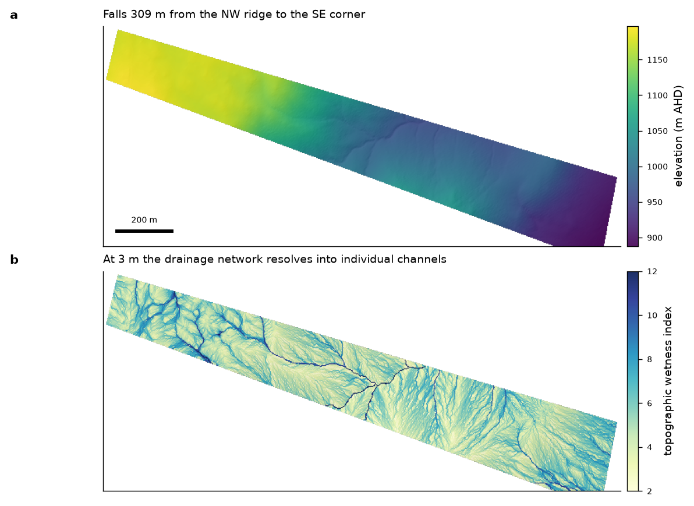

# pylidarterrain

Bare-earth DEMs and terrain derivatives from classified airborne LiDAR.

Written for ICSM Level-3 classified clouds (Geoscience Australia ELVIS tiles and
equivalents), where ground returns carry classification 2.

```python
from pylidarterrain import Grid, build_dem, fill_voids, slope_aspect, horizon_angles

grid = Grid(e0=652000, n0=5966000, e1=656000, n1=5968000, res=3.0)   # EPSG:28355
dem, counts = build_dem("tiles/*.laz", grid)
dem = fill_voids(dem)
slope, aspect = slope_aspect(dem, grid.res)
hor, reach = horizon_angles(dem, grid.res, n_azimuth=32, max_distance=5000)
```

## The orientation trap

`assert_north_up(dem, aspect)` exists because of a real error. Binning points the
natural way — `(y - y_min)/res` — puts row 0 at the **south** edge; GIS rasters put
it at the **north** edge. Mixing the two mirrors the grid and inverts aspect.

In the Northern Hemisphere the mistake hides, because sun-facing ground still reads
as south-facing. In the Southern Hemisphere it inverts every insolation, temperature
and evapotranspiration conclusion you draw. Call the guard after computing aspect.

## Resolution and what the data supports

Ground-return density is the binding constraint, not the gridding. At the ~0.44
ground points/m² of a standard wide-area survey a 3 m cell holds about four returns
and roughly 4% voids; 1 m holds less than one and is mostly interpolation. Check
`counts` before trusting a fine grid.

## Worked example — 47 ha in the Snowy Monaro, NSW

Two 2018 Geoscience Australia ELVIS tiles (ICSM Level 3, 0.44 ground points/m²,
0.3 m vertical accuracy at 95% CI). 3.32 M ground returns gridded at **3 m**:
51,467 cells inside the boundary, a median of 4 returns per cell, 3.7% voids.



*Bare-earth elevation (887.9–1197.0 m AHD, a 309 m fall) and the topographic wetness
index (1.21–15.52) at 3 m. The wettest decile covers 4.63 ha. At this cell size the
drainage network resolves into individual channel threads; the 10 m grid smears the
same network into broad lines.*


*Grade across the block: median 29%, reaching 100% — a true 45° — on the gully walls.
The 10 m grid capped at 36.8°, so the steepest ground is not new terrain but terrain
the coarser cells averaged away. The same mechanism drops the shaded annual shortwave
minimum from 4841 MJ/m² at 10 m to 3477 at 3 m.*

Both panels are labelled in grade percent with degrees on the colourbar. 100% is 45°,
and reporting one unit without the other invites exactly the confusion the colourbar
is there to prevent.
