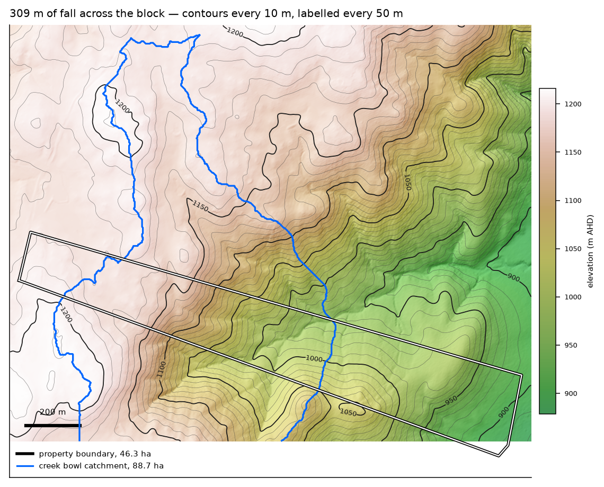
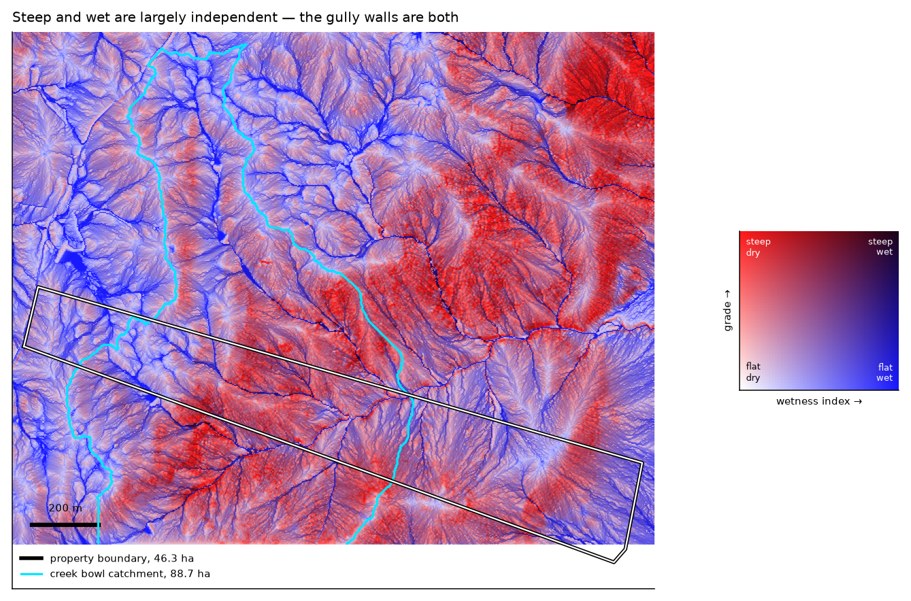
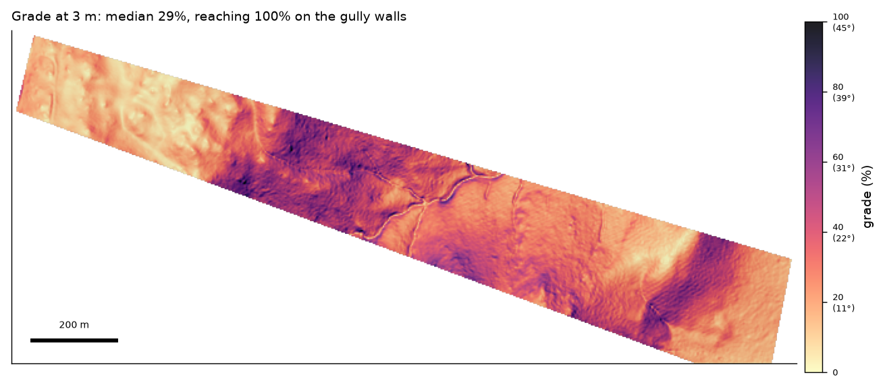
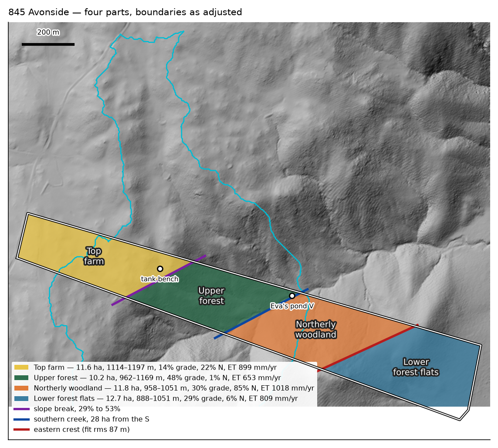
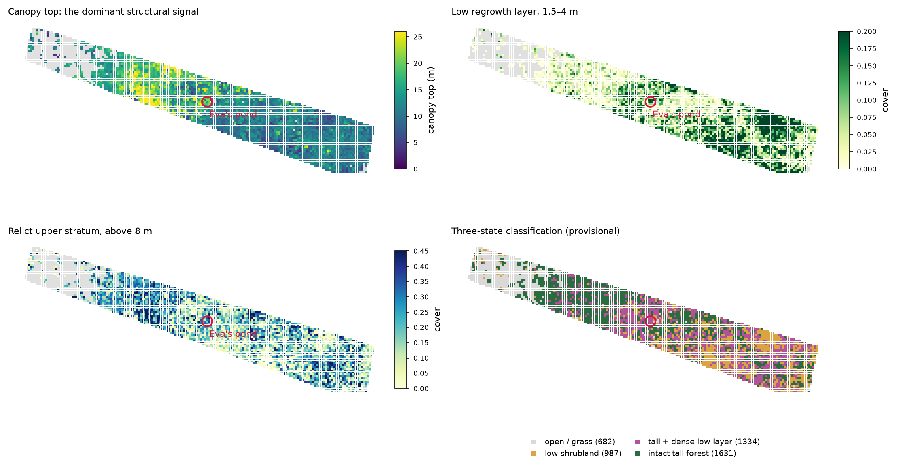
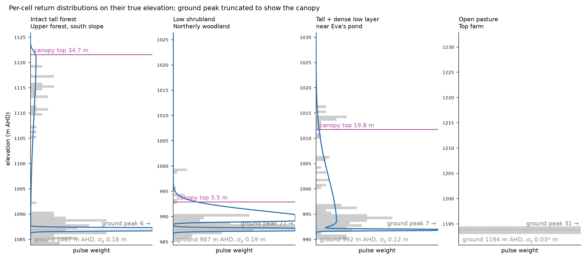

# pylidarterrain

**The ground a plant actually stands on, measured from the air.**

A contour map tells you where you are. It does not tell you what a plant
experiences. For that you need four things about every square metre: how steeply it
tilts, which way it faces, how much of the sky it can see, and where water collects
as it runs off. Those four decide how much sun a seedling gets, how long the frost
sits, how fast the rain leaves, and whether a spot is a gully or a spur.

This package builds those layers from classified airborne LiDAR — the survey product
councils and national mapping agencies already hold for much of the settled world,
usually free. Ground returns are separated from vegetation, gridded to a bare-earth
surface, and turned into slope, aspect, horizon angles and sky view. It is written
for ICSM Level-3 classified clouds (Geoscience Australia ELVIS tiles and
equivalents), where ground returns carry classification 2.

Everything downstream rests on this, so it is worth getting the resolution right: at
3 m a gully wall is a gully wall, and at 10 m it has been averaged into the hillside
around it.

## Where this sits

Six small packages, one chain. Each does one thing and each is useful on its own.

| package | reads | gives you |
|---|---|---|
| **pylidarterrain** (this one) | classified airborne LiDAR | **the ground surface a plant actually stands on: slope, aspect, how much sky it can see** |
| [pyterrainsol](https://github.com/jborevitz/pyterrainsol) | that surface + daily weather | light and evaporative demand, cell by cell, day by day |
| [pyterrainwind](https://github.com/jborevitz/pyterrainwind) | that surface + reanalysis wind | wind exposure, and the extra demand it carries |
| [pychannelform](https://github.com/jborevitz/pychannelform) | that surface | where the water goes: catchments, channels, long profiles |
| [pylandstore](https://github.com/jborevitz/pylandstore) | channels + demand | where to hold water, and what it costs to move it uphill |
| [pylandgraze](https://github.com/jborevitz/pylandgraze) | all of the above + a herd | where the animals should be, hour by hour and season by season |

## Quickstart

```python
from pylidarterrain import Grid, build_dem, fill_voids, slope_aspect, horizon_angles

grid = Grid(e0=652000, n0=5966000, e1=656000, n1=5968000, res=3.0)   # EPSG:28355
dem, counts = build_dem("tiles/*.laz", grid)
dem = fill_voids(dem)
slope, aspect = slope_aspect(dem, grid.res)
hor, reach = horizon_angles(dem, grid.res, n_azimuth=32, max_distance=5000)
```

## What it found at 845 Avonside

Two 2018 Geoscience Australia ELVIS tiles (ICSM Level 3, 0.44 ground points/m²,
0.3 m vertical accuracy at 95% CI). 3.32 M ground returns gridded at **3 m** over the
full 4 × 2 km tile union: 887,778 cells, a median of 4 returns per cell, 3.7% voids.
The block itself falls 309 m, from 887.9 to 1197.0 m AHD — **a property as tall as it
is wide.**



*The land itself: hillshaded elevation with contours every 10 m, labelled every 50 m.
At a median grade of 29% the 10 m lines sit about 35 m apart on the ground — close
enough to read the shape of a spur, far enough apart to stay legible where they crowd
to 25 m on the steep faces.*



*Steepness and wetness on one map: red is steep, blue is wet, dark is both, pale is
flat and dry. **The dark threads where steep meets wet are the gully walls above
active channels** — the ground that erodes if it is cleared and holds if it is
wooded. Drawn across the whole tile with the property boundary and the 88.7 ha creek
bowl overlaid rather than clipped to the title, because a boundary is a legal object
and three quarters of the bowl lies outside it.*

*The two layers are worth combining because here they are largely independent:
steepness and the wetness index correlate at only −0.35, since wetness is driven by
how much land drains into a spot (r = 0.92) rather than by the slope term in its own
formula (r = 0.36). A steep site is not automatically a dry one.*



*Grade alone: median 29%, reaching 100% — a true 45° — on those gully walls.*

**The resolution argument, in one number.** A 10 m grid capped this block at 36.8°,
so the steepest ground was not missing from the data, it had been averaged away. The
same smoothing puts the shaded annual sunlight minimum at 4841 MJ/m² on a 10 m grid
where the 3 m surface gives 3477 — **a 39% overstatement of the light reaching the
darkest ground on the property**, which is precisely the habitat a fern, a frost
hollow or a cool-climate seedling occupies. Coarse grids do not merely blur a
hillside; they delete its extremes, and the extremes are where the ecology is.

### The block divides into four parts along its own terrain



*The property is a narrow rectangle, 1914 m on a bearing of 108°, so the useful
coordinate is distance along that axis rather than easting. Three terrain features cut
it into four parts, each boundary a line in that frame.*

| part | area | elevation | median grade | % north-facing |
|---|---|---|---|---|
| Top farm | 11.6 ha | 1114–1197 m | 14% | 22% |
| Upper forest | 10.2 ha | 962–1169 m | 48% | 1.5% |
| Northerly woodland | 11.8 ha | 958–1051 m | 30% | 85% |
| Lower forest flats | 12.7 ha | 888–1051 m | 29% | 5.5% |

The parts came out of the terrain nearly even in area, 10.2 to 12.7 ha, which nobody
chose. What they are not even in is thirst: in
[`pyterrainsol`](https://github.com/jborevitz/pyterrainsol) the same four parts span
**365 mm/yr of evaporative demand, 68% of annual rainfall, and the two extremes share
a boundary.** That is the case for treating them as four properties rather than one.

The slope break between the top farm and the upper forest is the sharpest line on the
block, 29% grade to 53% across it. The southern creek enters from the neighbour's
28 ha catchment and runs diagonally northeast to the pond junction. The eastern crest
is the real divide — east of it water leaves toward the flats, west of it toward the
creek — and it is the least certain of the three, since the ridge is crisp at both
ends and broad in the middle.

### Canopy structure: three states, and one the data cannot resolve

Each 10 m cell gets its own ground plane and its own vertical distribution — a
Gaussian ground component plus a skew-normal canopy component, fitted to
pulse-weighted heights above that plane. No crown segmentation, so a tree that
has died back and reshot into several sub-crowns is still one well-defined
profile.



Reading the panels: canopy top carries most of the structural signal; the low
regrowth layer (1.5–4 m) is concentrated at the eastern, lower end; **relict
cover** — the surviving tall stems and dead branches above 8 m — is its mirror
image. The classification into open grass, low shrubland, tall forest with a
dense low layer, and intact tall forest matches the owner's field knowledge of
the block.

The ground plane is what makes this work on steep country. Tall-tree cells here
sit at a median 26.6° slope, so the bare earth falls 2.8 m across a 10 m cell
(7.5 m in the worst cell). Fitting a plane rather than cutting a single
elevation leaves a ground roughness of 0.12–0.19 m, and tree heights are then
measured from the ground a tree actually stands on.



What it will *not* do is tell a died-back stand from an intact one on its own.
The obvious construction — require a dense low layer *and* tall relict stems at
once — was tested against a field-identified dieback site and failed (AUC
0.582), because relict cover is mostly just a height measure. The strongest
indicator found, once stands are matched for height, is low-layer cover at AUC
0.692. At 0.81 pulses/m² with no within-crown sampling, that is close to the
ceiling. `dieback_score` is exported as experimental for exactly this reason;
see [docs/methods.md](docs/methods.md) for the full table and the negative
results.

## Methods

The conventions this package enforces, the traps it exists to prevent, and what it
deliberately does not do are in **[`docs/methods.md`](docs/methods.md)**.

Methods and results are kept apart on purpose. The methods travel to any site and
will be re-checked against new ground and simulated data; the findings above are one
46 ha property in the Snowy Monaro, some of them specific to it and some likely to
generalise. Either can then be argued with without disturbing the other.
