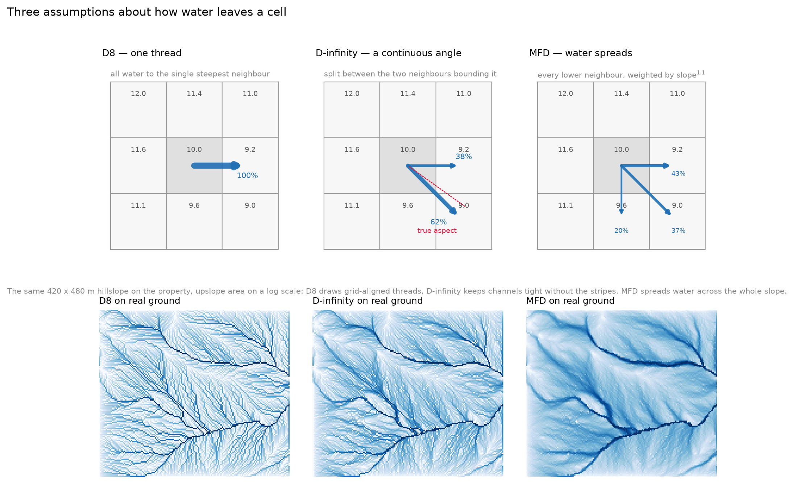
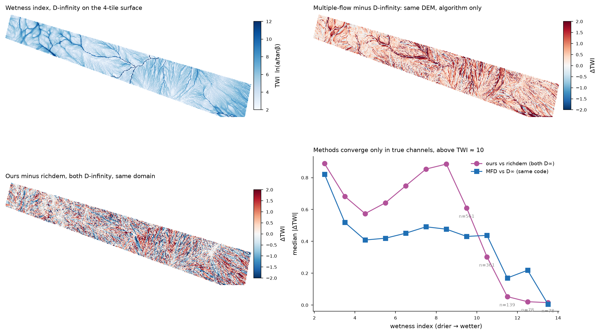
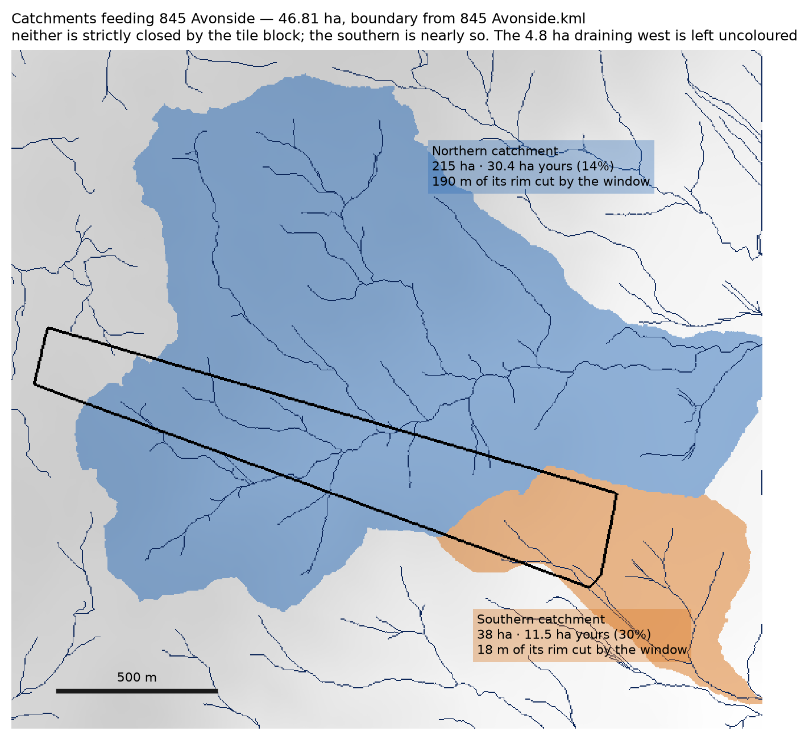

# pylidarterrain — methods

Conventions, traps and limitations. Findings from the block this was developed on are in the [README](../README.md).


## The orientation trap

`assert_north_up(dem, aspect)` exists because of a real error. Binning points the
natural way — `(y - y_min)/res` — puts row 0 at the **south** edge; GIS rasters put
it at the **north** edge. Mixing the two mirrors the grid and inverts aspect.

In the Northern Hemisphere the mistake hides, because sun-facing ground still reads
as south-facing. In the Southern Hemisphere it inverts every insolation, temperature
and evapotranspiration conclusion you draw. Call the guard after computing aspect.

## Resolution and what the data supports

Ground-return density is the binding constraint, not the gridding. At the ~0.44
ground points/m² of a standard wide-area survey a 3 m cell holds about four returns
and roughly 4% voids; 1 m holds less than one and is mostly interpolation. Check
`counts` before trusting a fine grid.

## Dividing a block into parts

On a long narrow property, northings and eastings are the wrong frame: every
boundary that matters runs across the long axis or along it. Fit the axis first
(principal component of the boundary vertices), then work in distance along it `s`
and perpendicular offset `p`. A boundary that is "roughly east-west across the
block" is then a line of constant `s - m·p`, and the single number `m` is its
obliquity — easy to fit, easy to adjust by hand, and easy to state.

Three ways to place such a line, in increasing order of trust:

- **A break in a terrain statistic.** Bin grade against `s` and look for the step.
  Reliable where the break is sharp; it gave 600 m here against a hand-placed 580.
- **A drainage line.** Take it from the flow grid, not from the DEM by eye.
- **A crest.** Fit the ridge as a line through the per-bin maxima of elevation and
  report the rms residual: 87 m here, against a block 1914 m long, which is honest
  about a ridge that is crisp at both ends and broad in the middle.

Report the residual and let the owner move the line. A boundary that the person
walking the ground disagrees with is wrong regardless of what the algorithm says,
and the parts exist to be managed, not to be optimal.

## Grade, not degrees — but label both

Report slope as a percentage and put degrees on the colourbar. 100% is 45°, and
quoting one unit without the other invites exactly the confusion the second axis is
there to prevent: a "50% slope" sounds like half of vertical and is 26.6°.

## Contours on a 3 m surface need smoothing; the lines do not need moving

Return-density noise puts kinks in a contour that no walker would recognise. A 4.5 m
Gaussian smooth before contouring removes them without displacing a line anywhere
visible on the ground. Choose the interval from the terrain rather than by habit: at
a median grade of 29% a 10 m interval puts lines about 35 m apart, legible on the
steep faces where they crowd to 25 m and still informative on the benches.

## Canopy structure from one distribution per cell

Crown segmentation asks "where is each tree?".  This asks a different question:
"what does the vertical profile of this 10 m cell look like?".  A stand that has
died back and reshot shatters into sub-crowns under watershed segmentation, but
it still has a perfectly well-defined height distribution.

Every return is weighted by 1 / NumberOfReturns, so each emitted PULSE
contributes total weight 1.0, split between the strata it hit.  Counting returns
instead would count a multi-return pulse several times and inflate canopy
against ground.  Drop overlap (class 12) and noise (class 7) first: on the
Avonside tiles class 12 runs 22-24% of returns, and a pulse-normalised metric
computed against that denominator is simply wrong.

### Why a plane per cell, not a DEM cut

Heights are measured above a ground PLANE fitted inside each cell by iteratively
reweighted least squares on the classified ground returns (median 45 per 10 m
cell at Avonside), not above a cell-mean elevation or a pre-built DEM.

This matters on steep ground.  Avonside's tall-tree cells sit at a median slope
of 26.6 deg, up to 36.8 deg, so the bare earth falls a median 2.8 m across a
10 m cell and 7.5 m in the worst cell on the farm.  Subtracting a single
elevation would smear that fall straight into the canopy component.  The plane
absorbs it, and the fitted ground roughness `sigma_g` comes back at 0.12-0.19 m
- residual roughness ABOUT the plane, which is what a sward-and-tussock term
should be.  A plane cannot follow convex ground, so `sigma_g` still inherits
some slope (Spearman 0.53); treat it as roughness plus curvature, not roughness
alone.

### Constraints, and the artefacts they create

The canopy location `xi` is floored and the ground width `sigma_g` capped to
stop the two components swapping roles.  Both bounds leave marks:

- A canopy floor at 1.5 m puts a 2 m regrowth mode ON its constraint, biasing it
  upward.  The default floor is therefore 0.5 m.  At Avonside 10.8% of tree
  cells still press it.
- A `sigma_g` cap at 0.40 m leaves returns between roughly 0.4 and 1.5 m
  belonging to neither component - a dead zone exactly where low regrowth
  starts.  The default cap is 0.60 m; only 1.0% of tree cells press it, so this
  relaxation is nearly free.

### Report a quantile, never the component mean

The canopy component's MEAN is a crown CENTROID, and at Avonside it sits a
median 4.83 m below the highest return, a gap that WIDENS with stand height
(7.14 m in the tall Upper forest).  Quoting it as a tree height is a
straightforward error.  `canopy_top` reads the 0.95 quantile off the fitted
skew-normal instead, which tracks the empirical 95th percentile closely: farm
medians 12.48 m model against 12.69 m empirical.

Family choice barely matters for fit quality - a head-to-head BIC over 305
forest cells and 27 isolated trees gave the skew-normal 47-56% of cells, a
reversed Weibull 26-37% and a Gaussian 16-19%, with median dBIC of 0 and +7
against the skew-normal.  The skew-normal is kept because its shape parameter
carries the structural signal below.

### Strata, and the term "relict cover"

Three bands, each as a fraction of total cell pulse weight:

| band | name | reads as |
|---|---|---|
| 1.5-4 m | low cover | regrowth, shrubs, new shoots after dieback |
| 4-8 m | midstorey | |
| above 8 m | **relict cover** | surviving tall stems and dead branches |

These are interception (gap-fraction) measures: within-crown gaps are excluded,
so they run below a crown-projection cover.  Cover and height are INDEPENDENT
measurements - over 4,104 tree cells they correlate at r = -0.088 - so a stand
description needs both.

### What separates dieback from shrubland, and what does not

A died-back stand and a true shrubland look alike from above: both are a dense
low layer.  The specified discriminator was a CONJUNCTION,
`2*sqrt(low_share * relict_share)`, high only where a dense low layer and tall
elements coexist.  It was implemented and tested against a field-identified
tall-dieback site, and it does not work.

Measured on TALL cells only (canopy top >= 14 m, so height is not doing the
work), dieback site against intact forest:

| indicator | dieback site | intact forest | AUC |
|---|---|---|---|
| low cover, 1.5-4 m | 0.074 | 0.030 | **0.692** |
| canopy skewness | -0.26 | -0.59 | 0.637 |
| 4-8 m valley depth | 0.113 | 0.066 | 0.615 |
| relict cover, above 8 m | 0.248 | 0.266 | 0.429 |
| conjunction score | | | 0.582 |

The last two rows are the explanation.  Relict cover is essentially a HEIGHT
measure, and within tall stands it is slightly LOWER at the dieback site than in
intact forest, so multiplying by it destroys the signal rather than sharpening
it.  A sweep of 18 variants - low bands 1.0-4, 1.5-4, 1.5-5 m; relict cuts 8, 10
and 12 m; normalised by canopy weight or by total weight - never beat AUC 0.589
against intact forest.

So the honest recipe is two stages, not one score:

1. `canopy_top` separates low shrubland from tall stands (AUC 0.734).
2. WITHIN the tall class, low cover is the dieback indicator (AUC 0.692), with
   canopy skewness as an independent confirmation.

Skewness works for a physical reason: an intact closed crown surface packs its
weight just under the top with a thin tail downward (strongly negative skew),
while a died-back stand spreads weight down the profile toward symmetry.

### How much of this is a density limit

The Avonside capture is 0.81 pulses/m2 - about 65 effective pulses in a 10 m
cell - and 95% of canopy returns are FIRST returns, with none third-or-later.
There is essentially no within-crown sampling, so no index computed here can see
crown openness; all of them see the crown SURFACE.  The dieback-site AUCs above
are also a FLOOR rather than a ceiling, because that reference patch is itself
mixed: erosion gullies dropped the water table and only some trees died, so it
contains tall healthy trees alongside the dead ones.

`dieback_score` is exported as EXPERIMENTAL for testing on denser captures.  It
is not a validated classifier at this density, and the `conjunction` method is
published mainly so the negative result is reproducible.

## Flow routing without a GPL dependency

Depression filling and flow accumulation were previously delegated to richdem,
which is GPLv3 and therefore blocks sharing code into MIT projects. Both are now
implemented here:

- `fill_depressions` is priority flood (Barnes, Lehman & Mulla 2014) with an
  optional epsilon gradient across flats. On the 4 x 4 km 3 m block it runs in
  1.9 s and raises 0.54% of cells, by at most 4.01 m.
- `slope_aspect` is Horn's 3x3 finite difference. Against the richdem-derived
  3 m grid over 51,467 farm cells it is IDENTICAL: r = 0.9999, median absolute
  difference 0.000 deg on slope, and aspect differs by more than 10 deg in only
  0.07% of cells - all of them flats, where aspect is undefined.
- `flow_accumulation` offers `dinf` (Tarboton 1997, the default), `mfd`
  (Freeman 1991) and `d8`. D-infinity takes 1.7 s on the same block.

### Accumulation does NOT reproduce richdem, and the reason matters

Slope and aspect match exactly; accumulation does not. Our D-infinity against
richdem's D-infinity, on the same domain and the same fill, gives a wetness
index correlation of only r = 0.773. Extending the DEM from two tiles to four is
NOT the explanation - our own four-tile and two-tile results agree at r = 0.9994,
because land BELOW the farm adds no upslope area to it.

Where the disagreement sits is the useful part. Median absolute TWI difference
by wetness band, for two D-infinity implementations and for two ALGORITHMS run
from identical code:

| wetness band | ours vs richdem (both D-inf) | MFD vs D-inf (same code) |
|---|---|---|
| TWI 2-3 (ridges) | 0.89 | 0.82 |
| TWI 4-6 (hillslopes) | 0.57-0.64 | 0.41-0.42 |
| TWI 7-9 (hollows) | 0.75-0.89 | 0.45-0.49 |
| TWI 11+ (channels) | 0.02-0.05 | 0.17-0.22 |

Two implementations of the SAME algorithm converge in channels; two different
algorithms still differ there by about 0.2, far less than the 0.4-0.9 they
differ by on hillslopes. So a channel structure - a leaky weir, a crossing - is
much less sensitive to the routing assumption than a hillslope work is, though
not wholly insensitive.

For planning the harder problem is that hillslope RANKING is unstable: among
hillslope cells (TWI < 9) the methods agree on only 55-66% of the wettest
decile, so about a third of candidate contour-bank sites move when the
assumption changes.



None of these algorithms is "true". They are three assumptions about how far
water spreads before it collects: D8 sends everything down one thread, MFD
divides between all lower neighbours, D-infinity splits between the two
neighbours bounding a continuous flow angle. D-infinity is the default as the
usual choice for a wetness index, but treat a hillslope value as
assumption-dependent and check it on the ground before building anything.



## The four-tile block, and which catchments it closes

The DEM is built from four Berridale 2018 ELVIS tiles covering
E 652000-656000 / N 5964000-5968000 - 1333 x 1333 cells at 3 m, elevation
779.5-1223.6 m, 3.86% voids before filling. It rebuilds in about 1.6 s:

```python
grid = Grid(652000, 5964000, 656000, 5968000, 3.0)
dem, count = build_dem(sorted(glob.glob("*.laz")), grid)
dem = fill_voids(dem)
```

The DEM array is deliberately NOT committed. Rebuilding from the tiles is faster
than cloning a 7 MB binary, and a committed array silently goes stale against the
code that made it.

The southern pair of tiles is what lets a catchment be closed rather than cut off
at the property fence. Against the 46.81 ha title boundary, the block drains
three ways:

| catchment | area | on the property | outlet | complete? |
|---|---|---|---|---|
| Northern | 215 ha | 30.4 ha (14%) | 862 m | slightly clipped |
| Southern | 38 ha | 11.5 ha (30%) | 811 m | nearly closed, 18 m of rim cut |
| Western | >375 ha | 4.8 ha (1%) | 1021 m | badly truncated |

The share of a catchment lying inside the boundary is what decides whether works
can change its flow: 30% in the south, 1% in the west. NONE of the three is
strictly closed by the tile block - measured as boundary cells falling on the
window edge, the southern loses 18 m of its rim, the northern 190 m and the
western 1.8 km. So the southern is the closest to a water balance without an
open boundary, but its area is still a lower bound.


